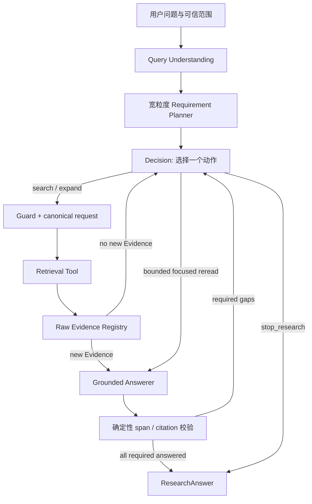

# Agentic Research 当前架构

核对日期：2026-10-12。生产入口是 [factory.py](../../paperbase/agentic/factory.py)、[graph.py](../../paperbase/agentic/graph.py) 与 [contracts.py](../../paperbase/agentic/contracts.py)。

## 设计目标

检索到的原始 Evidence 不再经过一个会丢失语义的中间“支持判定”门。Registry 保存全部去重 Evidence，Grounded Answerer 直接阅读完整 Evidence Pool，为每个 required Requirement 生成答案或明确缺口，并只返回 `evidence_id + source_span_ids`。程序负责恢复原文和验证引用，不替模型补造语义支持。

## 模块职责

| 模块 | 输入 | 输出 / 权威边界 |
|---|---|---|
| Query Understanding | 原问题、会话上下文 | `QueryContext`：规范化问题、意图、范围与证据类型；不生成检索 query/关键词，不直接执行检索 |
| Planner | 问题与范围 | 宽粒度 `ResearchRequirement`：ID、description、required、evidence_targets |
| Decision | 当前 Requirement、缺口、Evidence 元数据目录、最近工具结果、预算 | 一个合法 Action 及其参数；不声明 support/satisfied |
| Canonical compiler + Guard | Action | 唯一 effective request/identity，检查范围、重复与预算 |
| Tools | canonical request | 原始 `RetrievedEvidence` 与真实执行回执 |
| Evidence Registry | Tool Evidence | 稳定 E#/REF#、provenance、检索来源和 Requirement 请求绑定；不判断语义支持 |
| Grounded Answerer | 原问题、全部 Registry Evidence、本次尚需处理的 required Requirements | 每项 `answer + citations` 或 `remaining_gap`；已接受项由程序保留，不要求模型重复输出 |
| Answer validator | RequirementAnswer draft | 逐 Requirement 校验 citation/span；缺证据说明归一化为 gap，失败项单独修复，合法兄弟项立即保留 |
| Span validator | citation IDs | 检查 Evidence 存在、span 存在与顺序；有序稀疏选择拆为多个连续 anchor，恢复逐字原文；明确符号/方法名须出现在引用原文中 |
| Graph | Answer attempt | complete 时结束；有 gap 时反馈 Decision；同一 Evidence 快照最多一次聚焦重读 |
| Renderer | 已校验 RequirementAnswer | 确定性 `ResearchAnswer`，不新增事实 |

## Agent loop

1. Planner 只拆宽粒度回答义务，不预先编排固定 workflow。
2. Decision 每轮只看完成下一步所需的原子视图，选择搜索、章节扩展、overview、受限聚焦重读或 `stop_research`。
3. 工具结果经 Evidence Admission 和去重后进入 Registry；原始正文一直保留。Registry 快照只要出现尚未评估的新 Evidence，Graph 就直接进入 Grounded Answer，不让 metadata-only Decision 猜测证据是否充分。
4. Grounded Answerer读取当前 Registry 的全部 Evidence。不存在旧的最终 Evidence 数量上限；`try_answer` 只保留为相同 Evidence 快照的一次受限聚焦重读。
5. Answerer 只输出本次仍待处理的 required Requirement：能回答则引用 source spans；不能回答则输出具体 gap。若模型把“现有证据没有说明”写入无引用 answer，程序丢弃该段文字并保留 gap。
6. 校验和提交以 Requirement 为单位。合法项立即进入本地 accepted 集合；repair 的 Schema 与 Prompt 只包含失败项，已接受项不再发送给模型，也不会因兄弟项失败而丢失。
7. 若仍有 gap，Decision 只围绕实际 gap 决定是否继续检索。相同 Evidence Pool 允许一次聚焦重读，防止模型偶发漏读；再无进展则必须检索或停止。

## 关键契约

- `ResearchRequirement` 保持宽粒度。`evidence_targets` 是检索意图提示，不是支持结论。
- `EvidenceRecord.requested_requirement_ids` 只记录这条 Evidence 因何被找到；Answerer 可以把它用于任何 Requirement。
- `GroundedCitation` 保存 `evidence_id`、连续 `source_span_ids` 和程序恢复的 `source_excerpt`。模型若在同一 Evidence 中选择多个有序但分离的区间，程序只按 gap 拆成多条 citation；不扩张、重排或补 span。未知、重复、乱序及过度碎片化仍为硬失败。
- `RequirementAnswer` 二选一：有 answer 时必须有 citation；无 answer 时必须有非空 `remaining_gap` 且不能带 citation。
- Requirement 中明确命名的符号或方法标识符（例如 `C_i`、`MLE-QV`、`MPIWcapt`）必须在至少一个引用原文 span 中出现。该规则只验证直接词面锚点，不替代语义 entailment 判断。
- `GroundedAnswerAttempt.evidence_ids` 仅表示实际引用的 Evidence；完整输入快照另存于 `ResearchRunResult.answer_input_evidence_ids`。
- `selected_evidence` 是实际引用集，不再表示一个独立 Selector 的产物。
- `RequirementState.SATISFIED` 仅由已校验的 Grounded Answer 产生。

## Decision 输入

Decision 输入是确定性压缩视图，不传 Evidence 正文或预览。它包含 Requirement 状态与 gap、Evidence 的 ID/论文/章节/chunk 元数据目录、最近查询/工具结果、合法能力和预算。Decision 据此判断下一步动作，但不负责判断正文是否足以支持 claim；进入答案阶段时 Grounded Answerer 才读取完整 Evidence。超时重试使用真正更小的 compact view，不原样重发。

LLM-facing Action 使用单数 `requirement_id`，每次严格绑定一个 active Requirement；`search_papers` 可以在同一 Action 内查询多篇论文，但所有 search 都共享这个绑定。`semantic_query` 与 `lexical_terms` 由 Decision LLM 针对该 Requirement 生成，关键词为 1–5 个非空项。它们不能带入只属于其他 Requirement 的明确符号或方法标识符。程序对这种跨 Requirement 标识符做窄范围、确定性的校验，失败时只允许一次有诊断信息的 Decision 修复；它不做语义完成度判断。

通过 Schema 后，wire 字段会编译到内部 `AgentAction`。内部执行、Registry provenance 与 audit 仍保留 `query`/`requirement_ids`，因为它们描述已执行请求和历史关联，而不是继续暴露给 Decision LLM 的生成接口。Canonical compiler 决定实际检索请求与 duplicate identity。

## Checkpoint 与版本

当前 checkpoint semantic authority 是 `paperbase-agentic-grounded-answer-v1`。旧 Projector checkpoint 不迁移、不恢复执行；应新建研究线程。公开审计版本是 `grounded-answer-v1`。Decision wire contract 的评测由独立 v1.5 observer 读取，不回写历史 v1.4 产物。

## 安全边界

结构合法和 span 可恢复不等于答案事实一定正确。确定性评测能定位 retrieval → registry → answer input → cited 的丢失位置，但语义正确性、完整性和 citation entailment 仍需要人工或经校准的语义评测。生产 Answerer 的自报 complete 不是外部真值。
