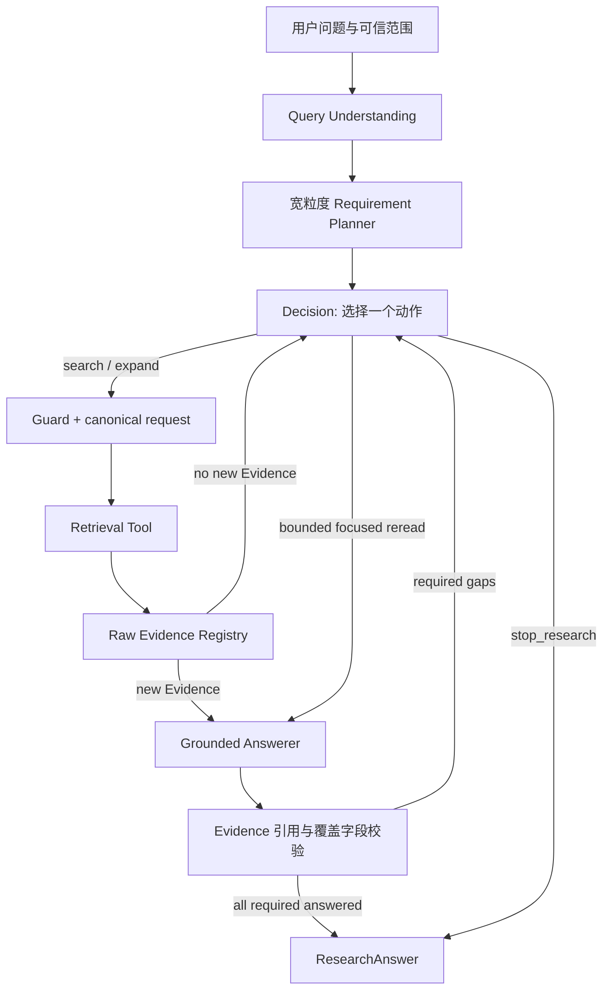

# Agentic Research 当前架构

核对日期：2026-10-12。生产入口是 [factory.py](../../paperbase/agentic/factory.py)、[graph.py](../../paperbase/agentic/graph.py) 与 [contracts.py](../../paperbase/agentic/contracts.py)。

## 设计目标

Registry 保存全部去重 Evidence，Grounded Answerer 直接读取每份 Evidence 的完整 `content`，围绕原问题生成一份连贯回答，再检查宽粒度 Requirements 的覆盖和缺口。引用粒度是完整 Evidence，不再要求模型选择 S span，也不再分别生成 Requirement 段落后机械拼接。程序检查引用身份与字段一致性，不替模型判定语义支持。

## 模块职责

| 模块 | 输入 | 输出 / 权威边界 |
|---|---|---|
| Query Understanding | 原问题、会话上下文 | `QueryContext`：规范化问题、意图、范围与证据类型；不生成检索 query/关键词，不直接执行检索 |
| Planner | 问题与范围 | 宽粒度 `ResearchRequirement`：ID、description、required、evidence_targets |
| Decision | 当前 Requirement、缺口、Evidence 元数据目录、最近工具结果、预算 | 一个合法 Action 及其参数；不声明 support/satisfied |
| Canonical compiler + Guard | Action | 唯一 effective request/identity，检查范围、重复与预算 |
| Tools | canonical request | 原始 `RetrievedEvidence` 与真实执行回执 |
| Evidence Registry | Tool Evidence | 稳定 E#/REF#、provenance、检索来源和 Requirement 请求绑定；不判断语义支持 |
| Grounded Answerer | 原问题、全部累计 Registry Evidence、全部 required Requirements | 单份整体 answer、正文实际引用的 citations、Requirements 覆盖与 gap；每次语义重读重新评估整体 |
| Answer validator | `GroundedAnswerDraft` | 校验引用 ID 存在、正文标记与 citations 一致、覆盖引用属于正文引用集；不宣称句子级定位或语义 entailment |
| Coverage repair | 已校验正文、失败覆盖项、累计 Evidence | 只修复失败的覆盖字段，不重写正文，不丢弃合法兄弟覆盖；仍未写入正文的信息必须保留 gap |
| Graph | Answer attempt | complete 时结束；有 gap 时反馈 Decision；同一 Evidence 快照最多一次聚焦重读 |
| Renderer | 已校验整体 Answer attempt | 保留整体正文，只附显式缺口说明，不新增事实或拼接 Requirement 段落 |

## Agent loop

1. Planner 只拆宽粒度回答义务，不预先编排固定 workflow。
2. Decision 每轮只看完成下一步所需的原子视图，选择搜索、章节扩展、overview、受限聚焦重读或 `stop_research`。
3. 工具结果经 Evidence Admission 和去重后进入 Registry；原始正文一直保留。Registry 快照只要出现尚未评估的新 Evidence，Graph 就直接进入 Grounded Answer，不让 metadata-only Decision 猜测证据是否充分。
4. Grounded Answerer读取当前 Registry 的全部 Evidence。不存在旧的最终 Evidence 数量上限；`try_answer` 只保留为相同 Evidence 快照的一次受限聚焦重读。
5. Answerer 先回答整个原问题，再对照 Requirements 检查正文实际写了什么。原问题要求但正文尚未解释的事实、关系或计算规则归入最相关项的 `remaining_gap`，不能因计划措辞笼统而遗漏。全体覆盖项均无支持且有显式 gap 时，无引用的缺证据说明归一化为 `answer=null`，不作为事实发布。
6. 整体正文引用非法时重试整体草稿；正文合法但覆盖字段非法时，只修复失败的覆盖项，固定正文和 citations，保留合法兄弟覆盖。修复耗尽仍保留合法正文与覆盖，失败项为 unresolved gap。不能通过覆盖字段修复替正文补造内容。
7. 新 Evidence 或受限同快照重读都会整体重新生成答案并重评全部 required 项，不冻结旧段落或旧 complete。若仍有 gap，Decision 针对缺失内容检索，不按编号轮流搜索。整体正文有引用且全部 required 覆盖无 gap 时结束；无合法有效路径或预算耗尽时保留 partial/insufficient。

## 关键契约

- `ResearchRequirement` 保持宽粒度。`evidence_targets` 是检索意图提示，不是支持结论。
- 原问题规定回答范围，Requirements 负责组织义务。Planner 不预设未经证据确认的数据流/因果方向；Answerer 根据原文纠正错误前提，不按某种固定 Plan 或检索顺序判断完成。
- `EvidenceRecord.requested_requirement_ids` 只记录这条 Evidence 因何被找到；Answerer 可以把它用于任何 Requirement。
- Admission 与 Registry 只复用完全覆盖的已有窗口；含新 chunk 的扩展窗口以独立稳定 ID 进入累计 Pool，触发 Answer。
- Answer 输入只有证据身份、文档位置和完整原始 `content`，没有 source_spans、历史 query 或检索 Requirement 绑定。
- `GroundedAnswerAttempt.answer` 是整体正文或 null；`citations` 是正文实际引用的去重 E#/REF#，正文使用 `[E1]` / `[REF1]` 标记。未知、重复、标记不一致的引用失败。
- `RequirementCoverage` 仅含 `requirement_id/evidence_ids/remaining_gap`：evidence_ids 是整体正文已回答该项所用的引用，必须是 citations 子集；无引用覆盖必须有 gap。status/complete 由这三个字段派生，不额外存储。
- `RequirementAnswer`、`GroundedCitation`、per-Requirement answer/citations、`accepted_answers` 已废除。source_spans 工具仅供历史诊断，不参与当前模型输入、输出或完成判断；不再把词面术语匹配当作回答支持门。
- `GroundedAnswerAttempt.citations` 不是完整输入集；完整快照另存于 `ResearchRunResult.answer_input_evidence_ids`。
- `selected_evidence` 是实际引用集，不再表示一个独立 Selector 的产物。
- `RequirementState.SATISFIED` 仅由当前 Evidence 快照上已校验的 Grounded Answer 产生；新 Evidence 会触发全量 Requirement 重评估。

## Decision 输入

Decision 输入是确定性压缩视图，不传 Evidence 正文或预览。它包含 Requirement 状态与 gap、Evidence 的 ID/论文/章节/chunk 元数据目录、最近查询/工具结果、合法能力和预算。Decision 据此判断下一步动作，但不负责判断正文是否足以支持 claim；进入答案阶段时 Grounded Answerer 才读取完整 Evidence。超时重试使用真正更小的 compact view，不原样重发。

LLM-facing Action 使用单数 `requirement_id`，每次严格绑定一个 active Requirement；`search_papers` 可以在同一 Action 内查询多篇论文，但所有 search 都共享这个绑定。`semantic_query` 与 `lexical_terms` 由 Decision LLM 针对该 Requirement 生成，关键词为 1–5 个非空项。它们不能带入只属于其他 Requirement 的明确符号或方法标识符。程序对这种跨 Requirement 标识符做窄范围、确定性的校验，失败时只允许一次有诊断信息的 Decision 修复；它不做语义完成度判断。

通过 Schema 后，wire 字段会编译到内部 `AgentAction`。内部执行、Registry provenance 与 audit 仍保留 `query`/`requirement_ids`，因为它们描述已执行请求和历史关联，而不是继续暴露给 Decision LLM 的生成接口。Canonical compiler 决定实际检索请求与 duplicate identity。

## Checkpoint 与版本

Checkpoint namespace 为 `paperbase-agentic-grounded-answer-v2`，semantic authority 为 `whole-evidence-grounded-answer-v2`。旧 Projector 及 per-Requirement Answer checkpoint 不迁移执行，需新建研究线程；历史产物不删除。公开审计为 `grounded-answer-v2`，不保留伪造的 span 精度或重复 Requirement 正文。Prompt 为 `grounded-evidence-answer-v3`，SDK schema 为 `paperbase_grounded_answer_v2` / `paperbase_grounded_coverage_repair_v2`，两种原始输出均捕获。评测契约 v5、trace v3，历史 observer 不直接复用新 wire contract。

## 安全边界

Evidence 引用合法只证明被引材料确实在输入中，不证明某个句子或窗口中的每个 chunk 已被正确理解。确定性评测定位 retrieval → registry → answer input → cited；语义正确性、完整性、entailment 仍需内容复核。Span validation 在新架构为 N/A，不可记为通过或与历史通过率比较。生产 Answerer 自报 complete 不是外部真值。
