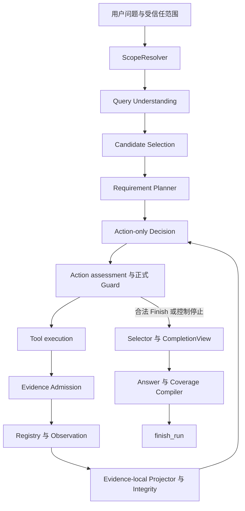

# Agentic Research 当前架构

核对日期：2026-10-08。主要入口：[factory.py](../../paperbase/agentic/factory.py)、[graph.py](../../paperbase/agentic/graph.py)、[contracts.py](../../paperbase/agentic/contracts.py)。Classic 另见[检索与生成](../pipeline/retrieval-and-generation.md)。

## 唯一权威分工

| 层 | 权威 |
|---|---|
| Query Understanding | advisory initial hints |
| Planner | Requirements 与 projection shape |
| Decision | 实际 Action |
| Canonical Search compiler | effective request 与 identity |
| Guard | legality 与 duplicate admission |
| Tools | 执行已接受请求，返回真实 observation |
| Registry | Evidence identity 与 provenance |
| Projector | scope 内局部支持判断、结构化声明与原文锚点 |
| Integrity / verified_support_ids | formal Requirement support |
| RequirementState | 从事实派生研究尝试与局部支持状态 |
| Selector | 最终 Evidence 选择 |
| Answer LLM | text、complete/partial/unsupported、coverage note；不改上游局部支持 |
| Deterministic Answer compiler | 无映射项 unsupported、citations、coverage IDs、overall、flags |
| E1 / E2 | E1 确定性诊断；E2 尚未实现 |
| Checkpoint | v4 执行语义；旧版只读，不迁移 support |

## 执行链

研究执行统一由 LangGraph 编排，旧 runtime、transitions 和 Claim qualification 执行路径已删除。

图表示主要职责关系；错误、空结果、兜底与中断恢复使用 Graph 原有条件边。Candidate Selection 用于全库候选筛选，既定论文范围不重新选论文。正式 Overview Tool 只读已有产物。

## 计划、检索意图与支持

ResearchPlan.requirements 定义回答义务：ID、description、required、evidence_targets、projection_type。投影类型包括 FACT、MECHANISM、COMPARISON、ENUMERATION。R# 属于 Requirement，Evidence 使用 E#，References 使用 REF#。

包括 exhaustive_enumeration 在内，合法 Planner draft 的描述、required、targets 和类型均按原值进入正式 Plan，由程序赋予稳定 R#。不再用固定“自身方法/baseline/prior work”三项替换模型义务。无模型或规划失败时，literal fallback 仅保留用户原问题的一项 required 义务；历史 deterministic_enumeration 标记仍可只读解析。

当前 enumeration 的实体 Schema 只承载 method/model/method_family；数据集、作者、指标或文献集合由 Fact 表达，完整列举范围仍保留。集合问题的 literal fallback 使用 Fact，避免在没有可靠类型判断时猜测实体域；模型规划的合法方法/模型 enumeration 不被覆盖。Planner 不做支持或完成度判断。

Query Understanding 提供 semantic/lexical 冷启动 hints，供 Planner/Decision 使用；不自动注入后续 Retriever，也不替 Decision 生成 Action。通过校验的 Decision Action 是实际工具输入的权威。

Action requirement_ids 表示请求要研究哪些 Requirement，不能直接视为支持。Plan evidence_targets 约束目标解释与 Projector 绑定，不作为 source/section 的隐藏检索过滤器。旧 Search DTO 上的同名 hint 不能独立覆盖 Plan 意图。

## Canonical Search Request 与 Score Contract

[requests.py](../../paperbase/retrieval/requests.py) 编译唯一的 effective request 和 identity，Guard 与执行器消费同一结果。Paper/KB 使用有效 semantic query、编译后的 lexical tokens 与实际后端参数。References 是 lexical-only FTS：显式 lexical 输入存在时，raw query 只用于 trace；缺少 lexical 输入才走确定性 query fallback。Lexical tokens 用于 OR 检索，不是精确短语。

成功执行的相同请求不可重复提交；receipt 区分 attempted、executed、successful、failed，临时失败不能冒充成功。动态 Schema 表达工具、ID 与参数结构域，canonical duplicate、Scope 和 budget 仍由 Guard 判断。

RetrievedEvidence 保存 raw_score、score_kind、score_direction、retrieval_rank。Dense、reranker、RRF 越高越好；正式 FTS5 BM25 越低越好；workspace BM25 越高越好。Overview/Section 等 non-ranked Evidence 不伪造数值 score。旧 score 只作 deprecated 兼容数据，未知语义不猜测。

没有跨 Retriever 的统一 calibration。Admission、Selector、Decision 不直接比较 heterogeneous raw_score，使用来源内 rank、类型、质量与 verified support 等信号。Admission 的 reranker 阈值只适用于明确标注 normalized、higher-is-better 的 reranker score；负数 FTS5 score 本身不是拒收理由。

## Registry、Projector 与 Integrity

Registry 保存稳定身份、来源、出现历史、requested_requirement_ids 和 assessment。当前投影权威是 assessment.projections[]：一个 Evidence 可按多个 Requirement/type 产生多个投影组。legacy singleton projection 仅供兼容读取，不能任选一个组代表全部。

Projector scope 仅为 requested_requirement_ids ∩ current Plan IDs，显式记录 evaluated_requirement_ids。新增目标只处理缺失 scope，保留已有 verified support。历史缺失 scope 保持为空，不从 requested/supported IDs 推断。

Integrity 校验每个投影的来源锚点、ownership、Requirement IDs 与结构，再聚合 verified_support_ids。模型建议的 supported IDs 与核验后的支持职责不同；cache 命中仍需现有核验。

Projector cache fingerprint 绑定 Evidence identity、问题、Plan goal、当前 scoped Requirement 的 ID/description/required/evidence_targets/projection_type、实际组 type 和 schema/prompt 版本。旧无语义指纹数据不能命中新请求；无关 Plan/Runtime 历史不进入该 key。

当前 Projector Prompt 版本 v17 明确支持成立时同时提交 Requirement ID 和原文候选；相关指标、定性可行性不能替代目标指标或实际测量，目标实质内容均未建立时不能借局部缺口制造支持。source_excerpt 必须逐字复制连续原文，不拼接片段或自行插入省略号，原文已有省略号可以保留；qualified 可具有合法空支持。Fact ownership 保留 this_paper、prior_work、general_background、unknown；unknown 不建立 Fact 有效支持，一般背景仍按直接支持标准判断。最终跨 Evidence 回答综合由 Answer 负责；Decision 只选 Action。Prompt 更新通过已有版本字段隔离旧 cache，不改变投影 Schema、Integrity 或 checkpoint v4。

## 状态不能混用

| 状态 | 实际含义 |
|---|---|
| RequirementState.SATISFIED | 已有 integrity-valid 局部支持，未证明完整回答 |
| RequirementCoverage.complete | critical anchors 覆盖，未判断答案语义完整性 |
| candidate_coverage.screening_complete | 候选论文筛选完成 |
| run COMPLETED | 工作流正常结束，Answer 未必 complete |
| AnswerRequirementCoverage.complete/partial | Answer LLM 对有支持的 required Requirement 判断语义完整性，经结构/引用校验 |
| AnswerRequirementCoverage.unsupported | 无 selected verified support，或 Answer 判断现有局部支持不能回答核心内容；未证明论文客观不可回答 |

Selector 依据支持覆盖增益、来源和 rank 等信号选择 Evidence。CompletionView 映射最终选中且核验的支持，不从 RequirementState 或 anchors 推断 Answer complete。

## Decision View 与拒绝恢复

Factored View 从 Graph State/Registry 确定性构建，不调 summarizer、不写回 State。soft history 用 recent_research_events 和 A#/Q# 引用去重；当前 blocked action/query 与 recovery 约束直接可读。RuntimeActionCapabilities 是当前工具和合法 ID 域的权威。

compact 与 shadow 共享当前 System Prompt；shadow 只对照完整输入序列化，不保留另一套完成/检索策略。两者候选筛选字段均为 candidate_coverage.screening_complete。输出前检查分别处理研究 Action 和 Finish，最终合法性仍由原 Runtime 裁决。

NoProgressSignal 只统计连续无 new_verified_support、连续无 added_evidence、section reads without support、duplicate rejections，以及独立的 last_new_support_iteration/last_new_evidence_iteration。另有 consecutive_no_targeted_support_actions 和 last_targeted_support_iteration：targeted support 按行动绑定的 requirement_ids 与 newly_supported_requirement_ids 的交集确定，前者统计连续未产生该交集的研究行动，后者记录最近一次产生该交集的 iteration。新增非目标 Requirement 的 support 不会重置 targeted 计数；这里不做语义判断。所有这些字段都是策略提示，不强制 N 次后 Finish、换工具或生成 query。

configured 兼容配方使用独立节点温度与 decision_thinking_enabled。当前配置与模板均启用 qwen38_recommended，但 Decision 与其他 Agentic 节点都关闭思考，使用非思考采样参数（温度 0.7、top_p 0.8、presence_penalty 1.5、top_k 20）；当前 openai_compatible / ModelScope 路径发送 json_schema、strict=true，仍须本地校验。服务未必执行全部 Schema keyword，发送 strict 参数不证明结构永远合法。当前 .env.example 使用 ModelScope / Qwen，不再推荐智谱配置。

最新恢复复用原 Guard/canonical compiler：候选在 disposable tracker snapshot 上预检；拒绝后在现有 attempt pool 内最多即时提交一个替代候选，同属一个 research iteration。正式 Graph Guard 再次验证。模型自主选新检索、其他工具或 Finish；Finish 仍须原 closure。整个候选流程失败只计一个 invalid iteration。

last_action_rejection 是当前义务，action_rejections 是历史。Tool OK/EMPTY/PARTIAL 后清当前指针；ERROR/UNAVAILABLE 不误清；Finish 接受后清除。仅 Guard acceptance 不清除，历史不重新激活。node_max_attempts 同时限制结构化节点尝试与累计非法 iteration，合法动作不会重置累计值。

预检反馈通过原诊断 DTO，把 allowlisted rejected_effective_request 的 canonical identity/有效请求摘要传入模型。callback 是临时对象，不进 checkpoint。没有第二套 duplicate 判定、自动 query 或硬编码恢复路线。

References 的有效请求没有 Dense semantic_query，拒绝反馈用 null 明确表示不适用，保留真实 lexical 请求和 identity。lexical 重试提示读取 Pydantic 校验给出的上限，与现有 Schema 的 5 项一致。当前两例 live 已确认 search_papers 的完整拒绝摘要实际可见；References 修复尚未在 live 触发对应分支，保持离线验证界限。

## Answer 与 Coverage Compiler

Agentic provider 输出 AnswerSemanticDraft，只有五字段：direct_answer、evidence_explanation、reading_interpretation、requirement_status、coverage_note。requirement_status 的 keys 恰好是有 selected verified support 的 required IDs，值为 complete/partial/unsupported；无支持映射项由程序设为 unsupported。映射限定可用证据范围，不强迫 Answer 宣称核心可回答；unsupported 不修改 Evidence assessment 或 RequirementState。

程序解析前三个正文字段中的 E#/REF# inline citations，按首次出现顺序稳定去重，再和各 Requirement 的允许支持取交集。coverage_note 引用不算正文 used support。complete/partial 必须实际引用至少一个允许支持，不能自动补引用。unsupported 的 coverage.evidence_ids=[]；其专属证据不能继续作答引用，共享证据可用于其他已接受项。全部 unsupported 时输出 insufficient，无作答引用；正文说明当前证据不足，不能把局部缺失升级为整篇论文未报告。

[compile_answer_requirement_coverage](../../paperbase/generation/answer_coverage.py) 唯一构造 coverage rows，按 Plan required 顺序输出。overall 与 partial/insufficient 标记由 coverage/引用派生，程序不重新做语义完整性判断。

Answer 有一次定向结构/引用 repair 和原 transport retries。repair 不能语义升级，complete 可降为 partial/unsupported，partial 可降为 unsupported。Schema v3/Prompt v4，raw output capture 兼容旧 v2 和当前 v3。公开 ResearchAnswer/AnswerRequirementCoverage DTO 不变；Classic 使用独立旧 draft。

Decision 独立配置 decision_timeout_seconds=60 和 decision_transport_max_retries=0。复用 SDK 的 with_options 创建共享 HTTP 资源的独立 facade，不改变其他节点的 SDK 默认重试。原 node_max_attempts=2 继续管理请求重试、结构修复和 Guard 恢复；不改变 Agent budget 或合法性。60 秒是请求超时配置，不是整个 case 的硬墙钟上限。

## Checkpoint 兼容

当前 semantic authority：projector-requirement-directed-multi-projection-v4。新 thread 写 v4，v4 可 interrupt/resume/resume_stream。历史 v2/v3 可 DTO parse、inspect、offline replay，但 resume/resume_stream 明确拒绝。不裁剪、推断或回填历史 support 来迁移执行语义。

Projector 的来源引用协议使用 Evidence-local `source_spans`。每个 span 包含 `span_id/start/end/span_type/text`；模型只返回按原文顺序连续的 `source_span_ids`，程序据此恢复精确原文，再生成内部 `RequirementSupportAnchor.source_excerpt`。Requirement、Decision、checkpoint 与 Answer 的业务契约不因传输协议改变。

## 验证边界

agentic-eval-v2 确定性 evaluator 已冻结；E2 SemanticAnswerJudge 尚未实现。2026-10-08 补丁前固定 8-case 单次复测为 4 complete/4 partial，unanswerable 拒答验收失败、synthesis 有 Decision 超时。本次拒答/重试补丁仅做离线回归，不把旧 live 当作新版本验证；尚未验证多轮稳定性或正式 Agentic 40-case。

search_papers 的拒绝反馈 serializer 已在先前实际输入中核验，不能再描述为仅离线；旧 profile 下即使反馈完整，模型仍出现重复。单次成功不能证明策略稳定或 Answer 语义正确。当前数据见[当前基线](../evaluation/current-baseline.md)，旧 run 独立保存在[归档](../archive/evaluation-baselines-20261006.md)。

budget 的逻辑节点调用数、Decision iteration 数和模型 attempts 是不同指标。Answer retries/repair 或 SDK retries 可能使实际请求更多；审计不能把 logical counter 当 wire request 总数。
