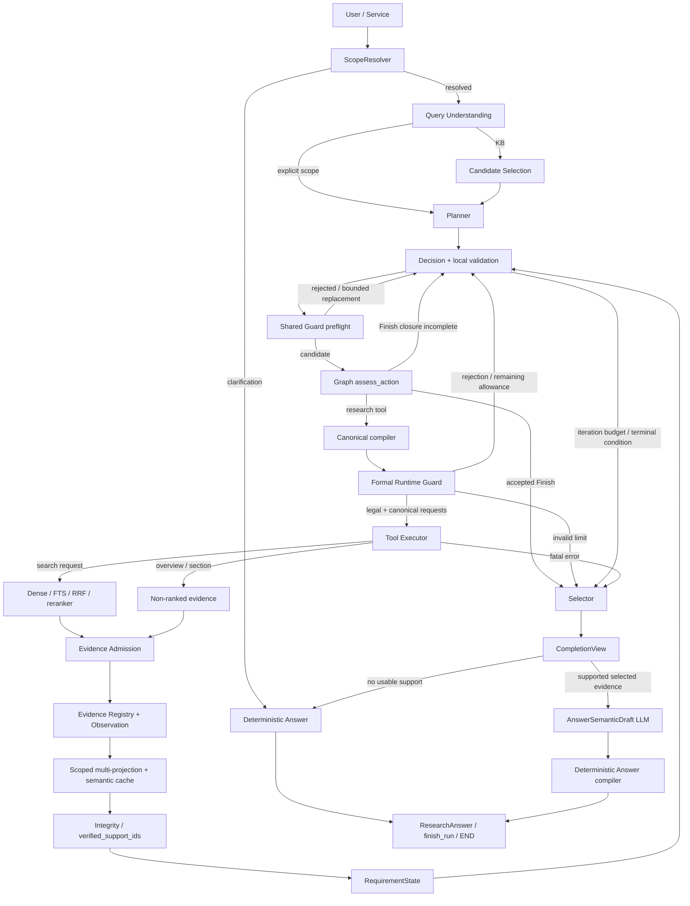
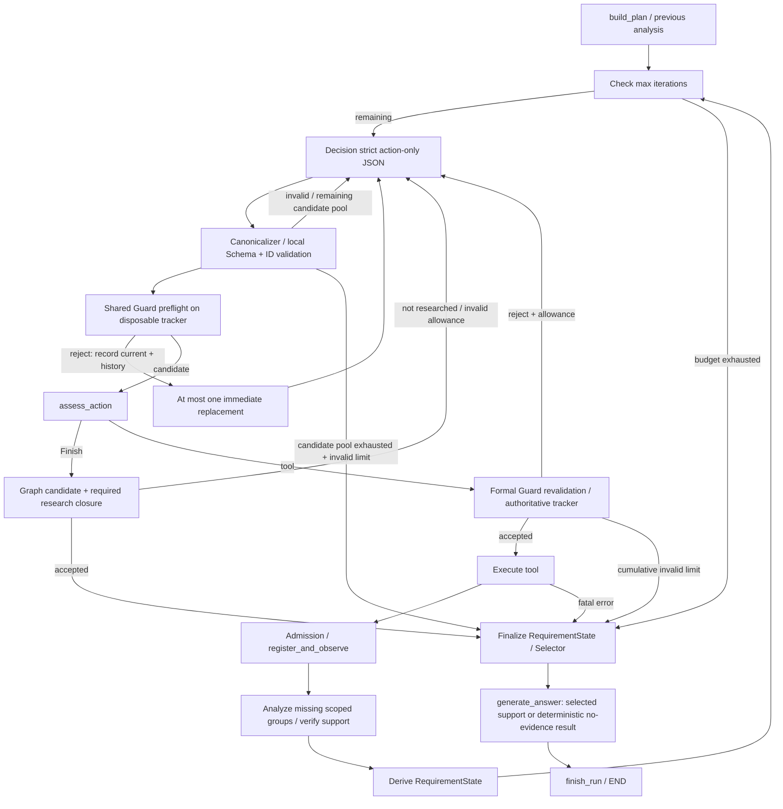

# PaperBase 当前架构快照 v1

## 一页摘要

当前模型是 `Qwen/Qwen3.8-Flash-Next`，通过 `api-inference.modelscope.cn` 的 ModelScope OpenAI-compatible 接口调用，Agentic 使用 `qwen38_recommended`。Decision 为 temperature=1 / thinking=true，其余五个节点为 temperature=0.7 / thinking=false；六个节点都不发送应用层 max_tokens。Decision、Planner、Projector、Answer 发送 strict json_schema，QU、Candidate Selection 发送 json_object。基线客户端与 Classic 的限额和采样仍独立，详见 [配置与评测](03_config_and_evaluation.md)。

正式链为 Scope → QU →（KB 时 Candidate Selection）→ Planner → Decision/Guard/Tool 循环 → Admission → Registry → Requirement-directed 多投影 → Integrity → RequirementState → Selector → Answer semantic draft → deterministic compiler → ResearchAnswer。Guard 是 research Action runtime legality authority；Finish 研究闭合检查在 Graph。实际检索输入只由 canonical compiler 生成；QU 的英文检索词是建议。Projector 提出局部支持，`verified_support_ids` 确认正式 grounding；模型声明 complete/partial，程序编译 unsupported、实际 citations 和 overall。

checkpoint semantic authority 为 `projector-requirement-directed-multi-projection-v4`；旧 v2/v3 仅允许离线 parse/inspect，不允许进入 resume 执行。E1 为 `agentic-eval-v2`；Golden `eval/datasets/golden_dataset_v1_2.jsonl` 当前 40 cases。E2 独立语义 Judge 尚未实现。

当前 profile 只有一次 method_002 成功 live 观察，尚无完整 8-case 稳定性或 40-case 验证。已知边界包括复杂状态下 Decision 重复选择、Projector 语义遗漏、缺乏独立 complete/partial 验证。严格结构与 grounding 不等于语义完备。此次只有只读检查和零 provider 测试，不新增 live 结果；共记录 7 项限制、0 处文档漂移、0 个限定审计范围内的 authority 冲突。

## 1. Metadata 与事实来源

Snapshot `paperbase-architecture-snapshot-v1`；生成时间 `2026-10-07T15:33:50.053750+08:00`（Asia/Shanghai）。Commit `e365bf9e27eaab29f554a3c3f8ec441b2c21a9d6`；dirty=`True`。

当前生产树 SHA256：`54766b03327438e05f56f3d7a6777907c5c089541c9eb1aba8463905c02f5e7d`（158 个 paperbase/app Python 文件，包含未提交文件）。配置 bundle SHA256：`59af7d9d7c859eace4993289182544c47fecbed28954334261d64a225b9ac4e5`。历史 commit 不代表当前 dirty tree，精确路径和哈希见 [source_hashes.json](source_hashes.json)。

事实优先级：当前 production source → 当前 config/factory 的有效组装 → DTO/schema/serde → tests → Evaluation/Golden metadata → docs。历史报告只作交叉检查。所有旧文件保持原样，漂移只记录。机器信息见 [architecture_snapshot.json](architecture_snapshot.json)，校验结果见 [snapshot_validation.json](snapshot_validation.json)。

## 2. 系统用途与入口

PaperBase 围绕本地论文知识库回答有来源的研究问题。Agentic 将问题拆成回答义务，再自主选择研究工具；Classic RAG 仍是独立检索/生成路径。UI Service 惰性创建服务，只有实际使用节点才调用模型。scope 优先可信 workspace，其次 UI paper IDs、all-KB 快照、显式论文 ID/标题/文件名；不明确或有歧义时先澄清。

当前正式 Agentic factory 面向 KnowledgeBase，未注册 workspace retrieval adapter。可信 workspace DTO 和低层适配能力存在，不代表当前 Paper Workspace UI 已接入同一 Agentic 工具链；Ask This Paper 走独立 Classic 服务。

## 3. 端到端实际调用链

Graph 实际注册节点和全部条件边另见 JSON `graph`；此图展开了节点内部的 compiler、preflight、Integrity 与 compiler 职责。工具请求在正式执行前编译，Guard 与 Executor 使用同一请求，不是在 Retriever 内重造 query。终止通常先进入 generate_answer，再 finish_run/END，不代表每个 stop 都调用 Answer LLM。

## 4. Agent Loop 与 stop

一次成功 candidate 或耗尽 Decision candidate pool 记一个 research iteration；同 iteration 的恢复请求不另算研究轮数。cumulative invalid counter 达到 node_max_attempts 后停止，合法动作不会清零这个计数。per-paper query budget 的拒绝可重规划，并非当前代码中无条件立即停止整个 run。

`StopReason` 存在 agent_finished、budget_exhausted、per_paper_query_limit、scope_unresolved、no_available_actions、invalid_action_limit、fatal_error。不能从枚举名称推断全部可达：当前未发现 NO_AVAILABLE_ACTIONS 的产生路径；no_evidence 是状态/回答分支，不是单独 StopReason。

## 5. Evidence lifecycle

| 阶段 | Producer / output | Authority 与失败含义 |
|---|---|---|
| Retrieved | Tool/adapter → RetrievedEvidence → Observation | 原始来源与 channel/rank；空结果、unavailable、error 不等同缺乏全局答案 |
| Admitted | Evidence Admission → admitted Evidence | 按明确来源/质量过滤；仅规范化 reranker 应用对应数值门槛；拒绝并不证明语义无关 |
| Registered | EvidenceRegistry → EvidenceRecord/RegistryState | run-local identity、source provenance、requested bindings；复用合并，不丢历史请求/来源 |
| Projected | Projector → EvidenceAnalysis.projections[] | 指定局部 scope/type 下结构化抽取；有效空支持允许，遗漏不能由程序补造 |
| Verified | Integrity → verified_support_ids | 只接纳已 qualified、合法 ID、真实 source anchor、类型特定 assertion/ownership；拒绝不会自动创造支持 |
| Selected | FinalEvidenceSelector → EvidenceUnits | 依据 required verified support/新信息/质量与 rank 选择；selected 不保证实际被引用 |
| Cited | inline parser + compiler → ResearchAnswer | 只有正文真实 E#/REF#、且属于已选对应 support domain，才能进入 citations/coverage.evidence_ids |

Registry 分配正文 E# 与 bibliography REF#，R# 是 Requirement；[R1]/[REQ:R1] 不属于引用命名空间。assessment 可含多个不同 projection shape，singleton accessor 是兼容读取，不是整体 authority。新分析 scope 始终为 requested_requirement_ids ∩ current Plan IDs，显式记录 evaluated_requirement_ids；旧 scope 不猜测、不回填。

Projector 按缺失的 `(projection_type, scoped Requirement IDs)` 分组，支持 fact、mechanism、comparison、enumeration。batch 是传输聚合；semantic cache 每组独立，identity 包含 source fingerprint、问题/goal、Requirement 的 ID/description/required/targets/type、group shape、schema/prompt version。cache hit 也过当前 Integrity。只修复/降级失败同伴，保留有效同伴；成功 scope merge 保留历史有效支持，失败重分析不能抹掉先前支持。

Integrity 是局部 grounding authority，不是独立 entailment Judge。fact/mechanism/comparison 检查 proposed/supported relation 和原文 anchor；enumeration 还检查实体、角色归属与 anchor。不通过词面相似或 requirement completion 猜测提升为支持。

## 6. Requirement lifecycle

研究状态固定为 pending / in_progress / satisfied / no_support_found / uncertain。Planner 定义有序 answering obligations（最多 8 个、稳定 R1…），每项描述、required/optional、evidence_targets、projection_type 是后续语义与路由依据，不是 Retriever hard filter 或 support 判断。

未尝试为 pending；已有尝试但无支持为 in_progress；有 verified support 为 satisfied，含义仅为找到局部有效支持。正常 finish 时无支持且无不确定分析信号的已研究项进入 no_support_found；存在分析失败/不确定信号或预算结束时进入 uncertain，未触及的 pending 保持 pending。旧 terminal 状态保留（satisfied 仍按当前 verified support 重算）。只有 agent_finished/budget_exhausted 触发当前最终研究状态 finalize，invalid-limit/fatal 等停止不应被描述为正常研究闭合。候选论文 screening coverage、critical-anchor 提示、Requirement research status 和 Answer coverage 是不同轴。Decision View 用 candidate_coverage.screening_complete，不能读成回答完整。

Answer 状态 complete / partial / unsupported 是最终回答阶段。`RequirementState.satisfied != Answer complete`；Finish 要求 required 项已经研究，不要求回答 complete。Selector 不重定义 support，只接纳能支持 required Requirement 的 qualified Evidence，先做集合覆盖，再用新实体/事实、质量/provenance、section/rank/stable ID tie-break；不横向比较不同 raw score。为保存唯一 required support，phase 1 可能超出 max_units；Agentic Answer 不再次截断这些 EvidenceUnits。

## 7. Search pipeline 与 score

QU 的 semantic_query_en / lexical_keywords_en 是 advisory initial search hints，Decision 可 reuse/rewrite/translate/split/ignore。Action 中实际 query/lexical_terms 才进入 canonical compiler，QU 提示不隐式合并进 Retriever。

paper/KB 请求具有 semantic query 与显式或 fallback lexical terms；semantic whitespace 归一但保留大小写/标点。lexical 做 NFKC/casefold、去重排序、停用词过滤；非空显式 hints 替换 fallback，未显式提供时提取最多 5 词。正式 FTS 使用 quoted 单词 OR，不等同 phrase search。显式 hints 全为停用词可产生空 lexical channel，paper/KB 仍有 semantic channel；reference 此时拒绝，因为 bibliography 只有 lexical route。

逐 request identity 为 search-v1 摘要，涵盖生效 scope/backend/top-k/source/workspace 等参数；Requirement binding、evidence_targets 与无效 raw audit 字符串不参与 identity。Agentic batch action identity 是这些 canonical IDs 的排序聚合 search-action-v1，不是第二个 search request authority。Guard 区分 attempted/executed/successful/failed receipt，成功请求去重，失败/unavailable 可以合法重试。

正式检索为 Dense + FTS + weighted RRF + normalized BGE reranker 和 context expansion；Agentic canonical path 不调用生成式 query rewrite。Classic rewrite 是独立仍活跃路径。RetrievedEvidence 明确 raw_score、score_kind、score_direction、retrieval_rank：dense/reranker/RRF 各按自身方向，正式 FTS5 BM25 lower-is-better，workspace BM25 higher-is-better；overview/section 为 non-ranked、无伪造 raw score/rank。legacy score 不从正负猜语义，不存在跨 channel 校准。扩展窗口继承最佳 seed rank/channel 信息，而非比较异构原始数值。

## 8. Answer 与 recovery

Answer provider 的五个字段固定为 direct_answer、evidence_explanation、reading_interpretation、requirement_status、coverage_note。requirement_status 仅含已选 verified support 对应的 required IDs，值为 complete/partial。程序按 Plan 顺序编译全部 required coverage，对没有 selected verified support 的项给 unsupported。

正文 inline citation 是 citation source；按出现顺序去重并校验选中/对应支持 domain，编译 citations 和 coverage.evidence_ids。有支持且 complete/partial 的项至少需要一个实际引用。overall 由程序推导：没有引用/有效 coverage 或全部 unsupported 为 insufficient，全部 complete 为 complete，其余 partial，进一步推导 partial_answer/insufficient_evidence。程序不证明模型 complete/partial 的语义真值。

有一次 targeted structural/citation repair 与一次 request-error retry。可保留合法原文、必要时 complete→partial，不自动补 citations 或升级语义。JSON 无法解析且无可保留草稿时使用确定性 fallback；失败 flags 不等于问题客观不可回答。disabled/clarification/failed/no-selected-support 路径可直接生成确定性结果。case runner 保存 Answer content 调试记录，隐藏 reasoning 不导出；这些不是 checkpoint/public answer/E1 score。原有 public Evidence audit 可包含 fact/anchors，本快照不复制内容。

Decision 使用 strict Action-only root，无 reasoning/$defs/qualifications 输出字段。动态 Schema 约束可用工具/ID/domain/section pairs，但当前没有 blocked-query 的 not/const recovery exclusion。Runtime legality 由共享 Guard preflight 和 formal Guard 再验证负责；preflight 使用 disposable tracker，不另造重复算法。被拒绝后最多一次 immediate materially-different replacement，仍受现有 candidate pool/deadline 限制。

current rejection 只表示现在仍需处理的拒绝：Tool OK/EMPTY/PARTIAL 成功后或 accepted Finish 清除；Guard acceptance 本身、Tool ERROR/UNAVAILABLE 不清除。历史 rejection 保留。semantic near-duplicate detection 与 Ephemeral Recovery Schema Exclusion 均 **NOT IMPLEMENTED**。

每次 Decision 调用构建新的 state view，不携带完整聊天 transcript；Graph State 是持久 authority。soft recent events 窗口为 3，压缩 lookup 与当前显眼 hard constraints 分开。NoProgressSignal 只作为策略提示，字段为 `consecutive_no_support_actions, consecutive_no_new_evidence_actions, recent_section_reads_without_support, recent_duplicate_rejections, last_new_support_iteration, last_new_evidence_iteration, consecutive_no_targeted_support_actions, last_targeted_support_iteration`。新增 sections/entities/reuse 不重置 support/evidence 计数；targeted support 只按新支持 IDs 与行动绑定 IDs 交集计数。无 support 不强制 finish，也没有 section 次数硬工作流。

## 9. Module map

| File/module | Responsibility |
|---|---|
| [app/services/paperbase_service.py](../../../app/services/paperbase_service.py) | UI Service 入口；惰性创建 Agentic/Classic 服务 |
| [paperbase/agentic/factory.py](../../../paperbase/agentic/factory.py) | 组装实际客户端视图、工具、分析器、Guard、Graph、checkpointer |
| [paperbase/agentic/scope_resolver.py](../../../paperbase/agentic/scope_resolver.py) | 确定可信 scope / 选定论文 / KB 快照与澄清 |
| [paperbase/agentic/query_understanding.py](../../../paperbase/agentic/query_understanding.py) | 意图、研究目标、advisory 初始检索提示 |
| [paperbase/agentic/candidate_selection.py](../../../paperbase/agentic/candidate_selection.py) | KB metadata 候选筛选；不读取正文支持 |
| [paperbase/agentic/planner.py](../../../paperbase/agentic/planner.py) | 回答义务、稳定 R#、Evidence targets、投影类型 |
| [paperbase/agentic/graph.py](../../../paperbase/agentic/graph.py) | Graph 节点/分支、迭代计数、Finish closure、停止与恢复生命周期 |
| [paperbase/agentic/decision.py](../../../paperbase/agentic/decision.py) | Action-only structured output、本地校验、共享 preflight、有限恢复 |
| [paperbase/agentic/decision_view.py](../../../paperbase/agentic/decision_view.py) | 无 LLM 的输入去重与确定性策略信号 |
| [paperbase/agentic/guards.py](../../../paperbase/agentic/guards.py) | scope、精确执行 identity 去重、预算、合法性；不生成替代 Action |
| [paperbase/agentic/search_requests.py](../../../paperbase/agentic/search_requests.py) | Agent Action 到低层 canonical compiler 的适配、batch 聚合 identity |
| [paperbase/retrieval/requests.py](../../../paperbase/retrieval/requests.py) | 实际 effective Retriever request 与逐 request identity 的编译 authority |
| [paperbase/retrieval](../../../paperbase/retrieval) | dense/FTS/加权 RRF/reranker/上下文扩展；Classic rewrite 独立 |
| [paperbase/agentic/tools.py](../../../paperbase/agentic/tools.py) | 接受已编译请求、执行注册工具、生成 Observation |
| [paperbase/agentic/evidence_admission.py](../../../paperbase/agentic/evidence_admission.py) | 来源和 quality/reranker 特定质量门槛 |
| [paperbase/agentic/evidence_registry.py](../../../paperbase/agentic/evidence_registry.py) | E#/REF# identity、provenance、bindings、assessment 合并 |
| [paperbase/agentic/evidence_projection.py](../../../paperbase/agentic/evidence_projection.py) | Requirement-directed 分组投影、batch/repair/fallback、cache 校验 |
| [paperbase/agentic/projection_semantics.py](../../../paperbase/agentic/projection_semantics.py) | 显式 local scope 的语义请求、cache fingerprint 输入 |
| [paperbase/agentic/grounding.py](../../../paperbase/agentic/grounding.py) | verified_support_ids；正式局部 Requirement support authority |
| [paperbase/agentic/requirement_state.py](../../../paperbase/agentic/requirement_state.py) | research 状态 derive / attempt tracking / finalize |
| [paperbase/agentic/requirement_coverage.py](../../../paperbase/agentic/requirement_coverage.py) | critical-anchor 检索覆盖提示；不决定 Answer complete |
| [paperbase/agentic/selector.py](../../../paperbase/agentic/selector.py) | 基于 required verified support 的确定性最终 Evidence 选择 |
| [paperbase/agentic/answering.py](../../../paperbase/agentic/answering.py) | CompletionView 与 Agentic Answer 桥接 |
| [paperbase/generation/answer_generator.py](../../../paperbase/generation/answer_generator.py) | 语义草稿、inline citation 解析、校验/修复/降级；Classic 独立契约 |
| [paperbase/generation/answer_coverage.py](../../../paperbase/generation/answer_coverage.py) | 程序编译 unsupported、实际引用支持、overall/flags |
| [paperbase/agentic/checkpoint_serde.py](../../../paperbase/agentic/checkpoint_serde.py) | DTO JSON adapter 与 checkpoint namespace |
| [paperbase/llm/client.py](../../../paperbase/llm/client.py) | provider 调用、structured format、immutable sampling views |
| [paperbase/evaluation](../../../paperbase/evaluation) | 冻结 Golden 校验、E1 deterministic evaluator/audit；E2 Protocol |

## 10. Evaluation 与阅读导航

E1 验证结构、source provenance、support/citation mapping、控制 trace 的确定性一致性，不判语义准确性。E2 SemanticAnswerJudge 只有 Protocol/DTO；尚无独立语义打分实现。完整 contract/authority 见 [02](02_contracts_and_authorities.md)，实际配置/版本/基线见 [03](03_config_and_evaluation.md)，真实未解决限制与漂移见 [04](04_known_limitations.md)。
