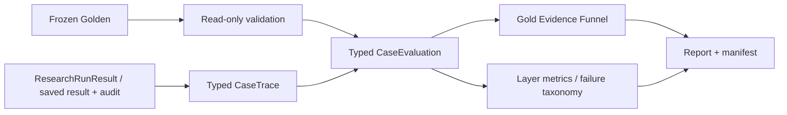

# E1 Agentic diagnostic evaluation contract

版本：`agentic-eval-v2`，evaluator 已冻结。本文定义确定性诊断，evaluator 不修改 Agent / Golden，不包含 LLM Judge 或模型调参。生产 Agent 的后续修复使用独立快照，不改变本契约。最新 live 与未通过的 gate 见[当前验证状态](current-baseline.md)。



## Existing evaluator reuse

| Existing module | E1 usage |
|---|---|
| `paperbase/evaluation/agentic.py` | Reuse `gold_chunk_ids` and `ranking_metrics`; retain v1 aggregate/taxonomy exports unchanged |
| `run_agentic_eval.py` | Reuse safe result envelope / JSON writer and normal service invocation pattern; original CLI unchanged |
| `run_agentic_only_eval.py` | Preserve v1 Agentic-only entry; E1 live likewise uses the production service without a separate Retriever run |
| `reclassify_agentic_eval.py` | Preserve old offline reclassification and baseline artifacts; E1 uses the same result/audit shape, with typed read-only adapter |
| `eval/scripts/validate_golden_dataset.py` | Reuse schema, enum, consistency, bibliography and read-only SQLite validation; discard its metadata-remapped copy |

E1 is an explicit new entry point, not a replacement of the existing evaluator. Old v1 behavior and tests remain valid.

## Frozen Golden validation

Actual schema of the 40 rows:

`id`, `question`, `primary_type`, `tags`, `paper_id`, `answerable`, `reference_answer`, `required_facts`, `relevant_evidence`, `expected_bibliography_intent`.

`relevant_evidence` contains `paper_id`, `section`, `page_start`, `page_end`, `chunk_ids`. There is no `expected_bibliography` list. Its actual contract is a boolean intent plus bibliography chunk provenance.

Type counts: fact 8, method 8, experiment 6, result 6, synthesis 4, bibliography 4, unanswerable 4. Questions, gold content and IDs remain frozen.

`validate_golden_dataset` reuses existing validators for ID uniqueness, enum/tag validity, answerable/reference/facts/evidence consistency, paper/chunk existence, paper ownership and bibliography section type. SQLite opens with `mode=ro` and closes explicitly. No remapped dataset is saved. Locator-only section/page differences are not converted into Agent failures: identity validation uses chunk/paper IDs, and no locator migration occurs.

Validation issues become `dataset_issues` with primary stage `dataset`, label `dataset_error`. Those records are excluded from Agent metric aggregates and Agent failure counts. Missing/unusable validation database is a dataset input error, not assumed valid gold. Live validation happens before provider construction.

`reference_answer` and `required_facts` are validated and retained in the original Golden for E2; E1 does not score lexical overlap or map them to Planner Requirements.

## DTOs and trace sources

`AgenticCaseEvaluation` contains typed `retrieval`, `research`, `evidence_funnel`, `answer`, `efficiency`, primary stage, secondary labels and gaps. `to_dict()` is JSON-safe. Small component dataclasses include per-Requirement and per-step records. `json_safe` handles dataclasses, enums, tuples, sets and Paths; unsupported arbitrary objects fail explicitly.

Current live capture consumes public `ResearchRunResult`:

- Registry records expose source/seed provenance and structured projections.
- `verified_support_ids` reuses current deterministic Integrity checks, with the current Plan domain.
- Observation's `evidence_filter_report.decisions` exposes pre-admission candidate source IDs, including rejected candidates. Complete capture requires decisions count equal total candidates.
- `request_executions` distinguish executed searches from a Tool call rejected before the backend. Context Tools contribute actual returned provenance.
- Plan, finalized requirement states, selected Evidence, public Answer/citations and existing diagnostics provide downstream fields.

E1 metrics do not manipulate Graph state or replace workflow/Tool behavior. Case runners additionally capture final Answer output for local debugging; this capture does not enter the frozen evaluator contract.

## Local Answer output capture

每个 live case 自动生成 `cases/<case_id>.answer_llm_outputs.jsonl`。E1 runner 与原 Agentic/combined runner 均接入同一机制，在 provider 返回后、文本提取与 JSON/Schema 校验前保存最终 `message.content`，不 strip、不修复、不截断；成功、非法 JSON、空 content、citation repair 的各次响应按 response_ordinal 记录。尚未调用 Answer 或请求未获得响应时文件为空，不能把固定 fallback 文案当作模型原文。

该文件是本地调试原始输出，包含完整 Answer 正文；不进入公共 audit、Graph checkpoint 或 E1 评分，不保存 hidden reasoning、输入 Prompt、API key 或完整 SDK response。历史 run 缺失的原文无法回填。离线 replay 不调用模型，也不生成伪造原始输出。

Historical adapter consumes saved result/audit only. Existing `evidence_source_chunk_ids` is usable when present. Missing source map, explicit verified IDs, modern projection array, evaluated scope or step receipts remain unknown. It never joins an E#/REF# to a chunk by ordinal, reruns today's FTS to guess old results, or treats `supports_requirement_ids` as verified. Old `new_supporting_evidence_count` is used as verified delta only when the corresponding audit provides explicit verified support authority.

## Gold Evidence Funnel

For each unique Golden chunk, intersect explicit Evidence provenance with the gold ID set. Current records include source and seed chunk IDs; source IDs also cover expanded context. Reused Evidence and repeated chunk appearances are set-deduplicated. No comparison to runtime Evidence ID alone.

Stages:

| Field | Meaning |
|---|---|
| `gold_retrieved_chunk_ids` | Gold exposed by any truly executed Search/context Tool; current Admission decisions include candidates later rejected |
| `gold_registered_chunk_ids` | Gold overlapping Registry Evidence provenance |
| `gold_projected_chunk_ids` | Gold overlapping Evidence with at least one structured projection; qualified status alone is insufficient |
| `gold_verified_chunk_ids` | Gold overlapping Evidence with explicit/current verified Requirement support |
| `gold_selected_chunk_ids` | Gold overlapping Final Selector output |
| `gold_cited_chunk_ids` | Gold overlapping selected Evidence referenced by final legal citations, or explicit saved audit selected/cited status |
| `gold_verified_selected_chunk_ids` | Gold overlapping selected Evidence units that themselves have verified support |

The last field prevents an unverified selected Evidence containing the same chunk from hiding the Selector's loss of a different verified unit.

These are **Evidence-window overlap metrics**. A verified/cited unit containing a gold chunk does not prove that the specific chunk supplied its support anchor or that all gold semantics were answered. E1 does not invent gold fact ↔ Requirement or fragment-level support mapping.

For incomplete histories, confirmed positive observations remain useful via `observed_gold_retrieved_chunk_ids`. Stage arrays/rates are null when missing provenance could change the gold set. If all gold is positively observed, gold exposure is known exactly even when non-gold provenance is incomplete. Unknown is never an empty set or zero.

## Retrieval metric definitions

| Metric | Definition |
|---|---|
| `hit_at_5`, `recall_at_5` | Existing exact chunk-ID Top-5 definition, only for an explicitly provided legacy standalone ranking; no initial/context ranking is substituted |
| `initial_search_hit` | Any gold in the first genuinely executed Search Action's returned candidates |
| `initial_search_gold_recall` | Unique gold in that initial Action / all gold |
| `cumulative_gold_retrieval_recall` | Unique gold exposed by all executed retrieval/context Tools / all gold |
| `queries_until_first_gold` | Executed search request ordinal through the first observable gold-producing single-request Search; null if prior provenance/receipts missing, the first hit is context-only, or within-batch request attribution is unavailable |
| `retrieval_queries` | Existing budget counter; if absent, exact executed search receipts only |

Initial Search is an Action, potentially containing multiple requests. Overview/section reads do not create a synthetic Top-K ranking or become the initial traditional Search. If no actual Search executed, initial metrics are not applicable. A context-only gold hit still increases cumulative recall.

Unanswerable cases have no gold denominator; gold retrieval rates are null. A missing rank/provenance is not a retrieval miss. A known empty executed retrieval is a valid observed miss.

## Requirement research metrics

`planned_requirement_count`: Plan requirements. `required_requirement_count`: required=True subset. `verified_supported_requirement_count`: planned IDs with at least one verified supporting unit. `unsupported_requirement_count`: planned minus verified supported, only if support authority is observable. `requirement_support_rate`: verified supported / planned; empty Plan gives null rate.

Per Requirement record: ID, description, declared projection_type, status, required flag and verified supporting Evidence IDs. Missing historic projection_type is null, never inferred from target or modern fallback shape. Status does not substitute for verified support.

Production Requirement support ≠ gold semantic completeness.

## Efficiency and Agent control

| Metric | Definition |
|---|---|
| `tool_calls`, `retrieval_queries`, `iterations`, `llm_calls` | Public budget counters; executed Tool count fallback only when exact step coverage exists |
| `decision_calls` | Distinct Decision iterations in complete Decision diagnostics; repair attempts share the same iteration |
| `decision_llm_calls` | Number of Decision model attempts, separately from node invocations |
| `guard_rejections`, `duplicate_rejections` | Existing Runtime rejected-action records / codes containing Duplicate; includes Runtime budget/domain legality feedback |
| `validation_errors` | Count of public structured validation diagnostic entries |
| `executed_actions` | Observed executed Tool boundaries, excludes rejected actions and finish proposal |
| `zero_support_actions` | Executed Tools with new verified support delta=0 |
| `actions_until_first_verified_support` | Executed Tool ordinal of first positive verified support delta; null if none found or unavailable |
| `consecutive_no_progress_peak` | Maximum consecutive executed Tools with verified delta=0; reset on positive support |

New Evidence or sections alone are not verified support. Missing deltas yield null counts. Historical model attempts lacking Decision iteration do not become estimated node-call counts.

## Deterministic Answer metrics

- `has_answer`: nonempty public answer text; missing text in legacy envelopes is unknown, not inferred from status.
- `insufficient_evidence`, `partial_answer`: explicit public flags.
- `citation_count`: unique explicit citation IDs.
- `citation_validity`: valid citations / all citations, requiring membership in both this Registry and Final Selector. No citations gives null validity; invalid IDs are listed.
- `selected_evidence_citation_coverage`: cited selected IDs / all selected IDs; no selection gives null denominator.
- `gold_citation_coverage`: unique gold in cited Evidence windows / gold.
- `correct_abstention`: unanswerable + explicit insufficient flag + no citations.
- `unsafe_non_abstention`: unanswerable + has public answer + explicit insufficient=false.
- `false_abstention`: answerable + explicit insufficient=true. Earlier retrieval/projection failures retain primary precedence.

E1 does not judge the substantive correctness of the text or infer abstention from words. Absent flags/text cannot become inferred safety conclusions.

## Failure Taxonomy v2

Primary precedence is the earliest **observable** failure:

1. Dataset validation error.
2. Scope/run setup failure explicitly provided by run/capture.
3. No usable Plan.
4. No gold exposed by fully observed retrieval, or only partial gold coverage.
5. Gold retrieved but no registered gold.
6. Gold registered but no verified gold support.
7. Verified gold units exist but no verified selected unit.
8. Selected gold not cited, inappropriate abstention, missing Answer, unsafe non-abstention, partial flag or invalid citations.
9. Control stop when no earlier observable failure is established.

Missing earlier layers are reported as gaps. A later observed primary stage does not certify unobserved earlier layers were healthy. Null primary + empty labels means no deterministic failure was established, not semantic correctness.

Labels include `dataset_error`, `retrieval_miss`, `retrieval_partial`, `gold_retrieved_not_registered`, `gold_registered_not_verified`, `gold_verified_not_selected`, `gold_selected_not_cited`, `false_no_support`, `false_abstention`, `unsafe_non_abstention`, `partial_answer`, `planner_validation_fallback`, `agent_search_stagnation`, `guard_rejection_loop`, `duplicate_loop`, `budget_exhausted`, `invalid_action_stop`; additional precise labels include `missing_answer`, `invalid_citation`, `no_usable_plan` and setup failure.

`planner_validation_fallback` requires recorded literal_fallback and last Planner diagnostic failed; a successful repair is not mislabeled. Loop/stagnation diagnostic thresholds are evaluator-only: duplicate_loop needs at least two duplicate rejections and control stop; guard_rejection_loop needs at least two Runtime rejections and invalid-action stop; stagnation needs a zero-support streak of at least two and control stop. None changes the Agent's next action, budget or finish policy.

Example: retrieved/registered gold, no verified support, budget stop → primary=projection; labels include `gold_registered_not_verified`, `budget_exhausted`. It must not be labeled retrieval_miss.

## Aggregation and historical comparison

Global and per primary_type: each stage rate is micro gold-chunk coverage, with observed cases and exact gold denominator. Conditional conversions use intersection(after,before)/before, excluding unknown endpoints. Zero denominator yields null. Other numeric metrics use known-case means and expose observed_cases.

`verified → selected` specifically uses `gold_verified_selected_chunk_ids`: an unverified selected sibling sharing the same gold chunk cannot count as successful transfer of a verified unit. Invalid/unselected citations never improve the cited stage. If Tool budget and observation count disagree, per-action completeness is unknown; missing steps cannot prove retrieval_miss or an exact no-progress count.

Dataset errors are excluded from Agent metrics. No overall semantic correctness number is generated.

Historical baseline comparisons are paired cases and identical definitions only: legacy standalone Hit@5 / Recall@5 when gold IDs agree, tool/retrieval counts and stop reasons. New initial/cumulative/Funnel values are not fabricated for v1. Failure definitions changed, so counts are not directly comparable. Replaying the old run does not measure current frozen production quality.

## Manifest and artifacts

`run_manifest.json`: run ID/schema, dataset path/SHA256, selected case count, UTC timestamp, mode, model/provider allowlist, Agent settings, production semantic authority, code snapshot (Git commit + dirty-content hash). Live writes manifest before cases. Keys/secrets/provider responses/prompt/hidden reasoning are excluded.

Historical source model/config/semantic version remain null/unknown when not saved. Current evaluator code hash is not presented as the code/model that generated historical answers. Historical input file hashes are saved and rechecked; result/audit inputs are untouched.

Live saves `cases/<id>.result.json`, `.audit.json`, `.evaluation.json`. The safe result envelope gains a typed public `case_trace` and final public Answer text, sufficient for exact subsequent replay. Replay writes only the derived evaluation and references original result/audit paths.

Run artifacts: `summary.json`, `metrics_by_type.json`, `failure_cases.json`, `run_manifest.json`, `evaluation_report.md`, validation, smoke selection and historical comparison.

## Running safely

Offline replay (no model/service construction):

```powershell
.venv\Scripts\python.exe -m paperbase.evaluation.run_agentic_e1 --source storage/evaluation/agentic_eval_glm45_p0_final_guard_20260923_40case --output eval/results/e1_historical
```

Representative selection: `--smoke`, fixed IDs `fact_001`, `method_001`, `method_002`, `experiment_001`, `result_001`, `synthesis_001`, `bibliography_001`, `unanswerable_001`. All seven actual types, eight cases; it references the same frozen dataset, not a new Golden.

Real provider execution is an explicit user CLI action, e.g. replace `--source ...` with `--live --smoke` after reviewing evaluator. The original evaluator implementation session performed no provider run. Subsequent authorized sessions have run real smoke. The current qwen38_recommended profile has one successful method_002 run, but no fixed 8-case stability suite or formal 40-case acceptance. The search_papers recovery-feedback serializer was verified in earlier live inputs; the old-profile instability remains historical evidence; see [current validation status](current-baseline.md). E2 `SemanticAnswerJudge` is only a Protocol/DTO extension point; never called or added to deterministic aggregate scores.

## Current production counting and recovery stages

Decision preflight uses the original Guard on a disposable tracker snapshot, with at most one immediate replacement candidate inside the existing attempts pool. Formal Graph Guard still validates accepted candidates. `guard_preflight_rejection`, schema/local validation failure, and formal Guard rejection are separate stages; do not sum overlapping current/history receipts as independent events.

E1 `decision_calls` counts distinct decision iterations; `decision_llm_calls` counts model attempts. Latest experiment tables label model attempts as “Decision calls”; compare with `decision_llm_calls`, not iteration counts. Tool execution counts and logical budget LLM counters have separate definitions. In particular Answer repair/retries and SDK retries can exceed a logical node count; a logical counter does not establish exact wire requests.

Selected verified support is not semantic Requirement completion. Production Answer emits complete/partial/unsupported for required IDs with selected local support; unsupported may decline that support at Answer scope without rewriting the Evidence assessment. The deterministic compiler supplies unsupported for IDs without selected support and constructs used-citation intersections. E1 checks observable contracts and provenance, not whether those semantic judgments are correct. E2 remains an uncalled extension point.
